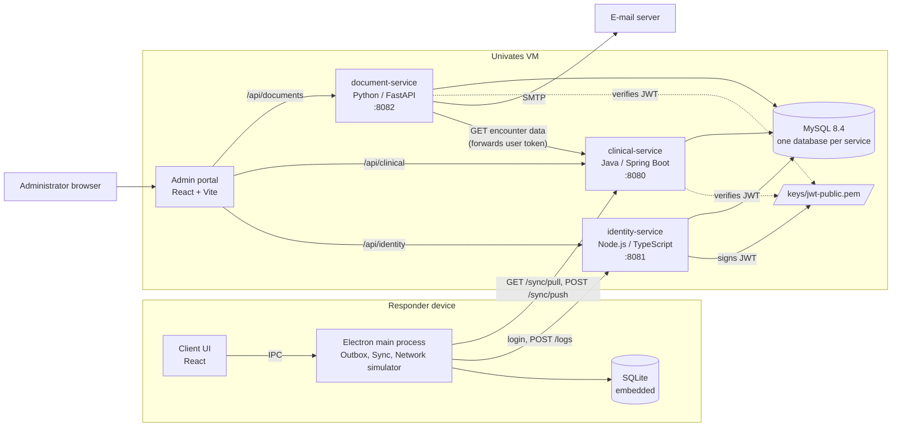
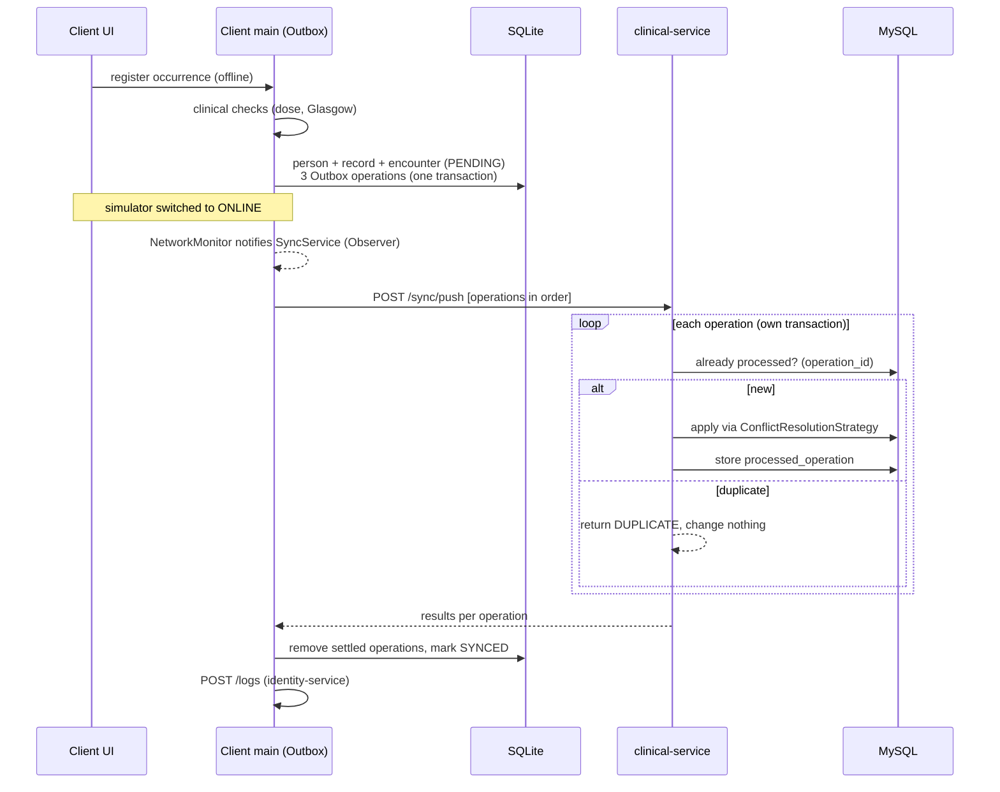

# MedicalField - Architecture

Emergency medical record for pre-hospital care (SAMU, highway ambulances, disaster teams),
built **offline-first**: the responder's device works without internet and synchronizes
when the connection returns.

## Overview

## Services and technologies

| Component | Language | Main technologies | Responsibility |
|---|---|---|---|
| `identity-service` | TypeScript (Node.js 24) | Express 5, jsonwebtoken (RS256), bcryptjs, mysql2 | Login, token issuing, professionals, access log, offline client logs |
| `clinical-service` | Java 21 | Spring Boot 4, Spring Data JPA, Flyway, MySQL | Medications, persons, medical records, encounters, sync (pull/push), conflict resolution, clinical safety rules |
| `document-service` | Python 3.12 | FastAPI, fpdf2, smtplib, PyJWT, PyMySQL | Care report (Ficha de Atendimento) PDF and e-mail delivery |
| `portal` | TypeScript | React 19, Vite | Administrative GUI: login, encounters, medical records, support registries, audit |
| `client` | TypeScript | Electron 45, React 19, `node:sqlite` | Responder GUI: offline registration, connectivity simulator, Outbox, sync |
| Database | SQL | MySQL 8.4 (server), SQLite (device) | Dual persistence |

## Key decisions

- **One database per service** (`medicalfield_clinical`, `medicalfield_identity`, `medicalfield_documents`).
  Services never read each other's tables; they talk over HTTP.
- **RS256 JWT**: only the identity service holds the private key. The Java and Python services
  verify tokens with the public key, so a compromised service cannot issue tokens.
- **Client-generated UUIDs**: records created offline keep the same id on the server, which makes
  references (person → medical record → encounter) work before and after sync.
- **Single write path in the client**: online or offline, every record is written to SQLite and to the
  Outbox first. Online, the Outbox is flushed right away.
- **Encounters are append-only**: a clinical event is never overwritten. Persons and medical records
  can change and use the conflict strategy.

## Synchronization

- **Idempotency**: each Outbox operation carries an `operationId`. The server stores it in
  `processed_operation`; resending the same batch returns `DUPLICATE` and changes nothing.
- **Conflict resolution** (server): `last-write-wins` by `updatedAt` (configurable to `server-wins`).
- **Pull merge** (client): records with local changes not yet sent (`PENDING`) are not overwritten.
- **Auditability**: every request is logged by each service; offline actions are logged locally and
  sent later; e-mails sent are recorded in `email_log`.

## Design patterns

| Pattern | Where | Purpose |
|---|---|---|
| Repository | `client/electron/database.ts` (`LocalRepository`), `client/electron/remote.ts` (`RemoteRepository`), Spring Data repositories | Isolates local (SQLite) and remote (REST) data from the screens |
| Strategy | `clinical-service/.../sync/strategy/*`, `client/electron/merge.ts` | Conflict resolution on push (last-write-wins / server-wins) and merge on pull |
| Observer | `client/electron/network.ts` (`NetworkMonitor`) | The connectivity simulator notifies the sync service, which flushes the Outbox when online |
| Command | Outbox entries (`client/electron/occurrence.ts`, `SyncService.apply`) | Each pending change is a self-contained command (id, type, payload), queued and executed later exactly once |
| Chain of Responsibility | Access-log → authentication filters in the three services | Each link handles one concern and passes the request on |
| Adapter | `document-service/app/pdf_renderer.py`, `email_sender.py` | Hides fpdf2 and SMTP/file delivery behind small interfaces |
| Facade | `document-service/app/care_report_service.py` | One entry point that gathers clinical data, renders the PDF and sends the e-mail |
