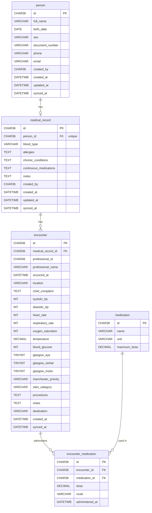

# MedicalField - Database model

Dual persistence: **MySQL 8.4** on the server (one database per service) and **SQLite** embedded in the client.
Ids are UUIDs (`CHAR(36)`) generated by the device that creates the record.

## medicalfield_clinical (clinical-service, Flyway migrations V1-V4)



Support tables:

| Table | Purpose |
|---|---|
| `processed_operation` (`operation_id` PK, `entity_type`, `entity_id`, `outcome`, `processed_at`) | Idempotency of sync operations |
| `access_log` (`occurred_at`, `client_ip`, `professional_id`, `method`, `route`, `status_code`, `duration_ms`) | Access audit |
| `flyway_schema_history` | Migrations applied |

`professional_id`/`created_by` reference professionals of the identity service; there is no foreign key
across services on purpose. `professional_name` is copied from the token so the encounter stays readable.

### Inserting medications manually (test script step 9)

```sql
INSERT INTO medicalfield_clinical.medication (id, name, unit, maximum_dose)
VALUES (UUID(), 'Morphine (Morfina)', 'mg', 10.00);
```

## medicalfield_identity (identity-service)

| Table | Columns |
|---|---|
| `professional` | `id`, `full_name`, `registry_type` (CRM, COREN, RESPONDER), `registry_number` (unique, login), `role` (ADMIN, RESPONDER), `password_hash` (bcrypt), `active`, `created_at` |
| `access_log` | same columns as above |
| `client_log` | `id` (from the device, makes resends harmless), `professional_id`, `device_id`, `occurred_at`, `level`, `action`, `details`, `received_at` |
| `schema_migrations` | migrations applied |

## medicalfield_documents (document-service)

| Table | Columns |
|---|---|
| `email_log` | `id`, `encounter_id`, `recipient`, `professional_id`, `status` (SENT, FAILED), `error`, `sent_at` |
| `access_log` | same columns as above |
| `schema_migrations` | migrations applied |

## Client SQLite (`medicalfield.db` in the app data folder)

| Table | Purpose |
|---|---|
| `setting` | session token, professional, device id, server URLs, last pull/push |
| `medication` | copy received in the pull |
| `person`, `medical_record`, `encounter` | local copies; `sync_status` = `SYNCED` or `PENDING` (encounter keeps the full payload as JSON) |
| `outbox` | pending operations in order (`seq`, `operation_id`, `type`, `entity_id`, `payload`, `status`, `attempts`, `last_error`) |
| `client_log` | actions recorded on the device, `sent` flag |
